# Сравнение решателей WCET

## [`hard-lp`](hard-lp/)

### curl-noproxy

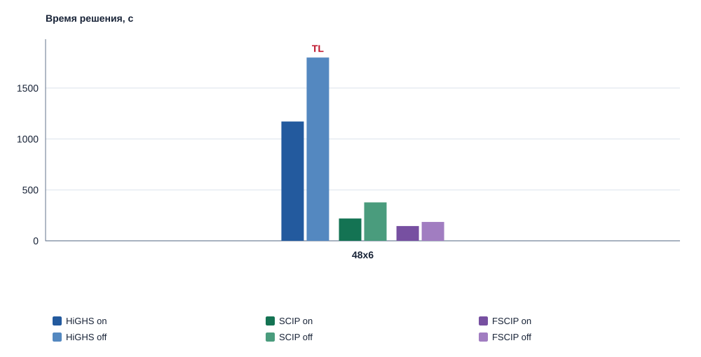

Время решения и статусы

| Задача | HiGHS on | HiGHS off | SCIP on | SCIP off | FSCIP on | FSCIP off |
|---|---:|---:|---:|---:|---:|---:|
| [48x6](hard-lp/curl-noproxy/48x6/README.md) | 1171,74 с · решено | TL (1800 с) | 218,97 с · решено | 377,12 с · решено | 144,95 с · решено | 185,25 с · решено |

### frr

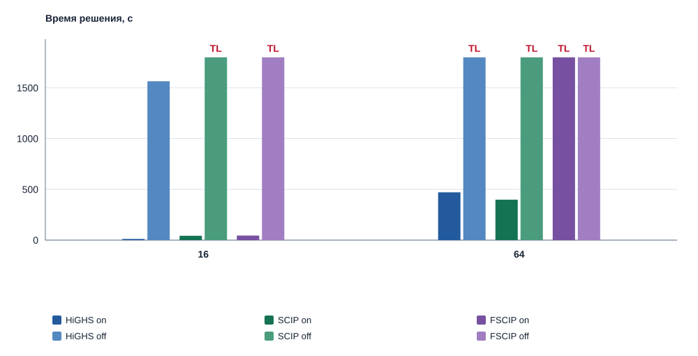

Время решения и статусы

| Задача | HiGHS on | HiGHS off | SCIP on | SCIP off | FSCIP on | FSCIP off |
|---|---:|---:|---:|---:|---:|---:|
| [16](hard-lp/frr/16/README.md) | 11,47 с · решено | 1564,87 с · решено | 42,83 с · решено | TL (1800 с) | 44,89 с · решено | TL (1800 с) |
| [64](hard-lp/frr/64/README.md) | 470,93 с · решено | TL (1800 с) | 398,27 с · решено | TL (1800 с) | 2305,93 с · решено | TL (1800 с) |

### getopt

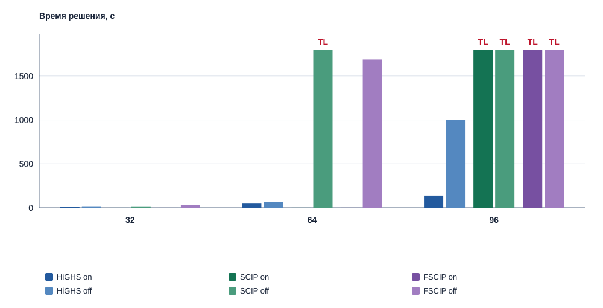

Время решения и статусы

| Задача | HiGHS on | HiGHS off | SCIP on | SCIP off | FSCIP on | FSCIP off |
|---|---:|---:|---:|---:|---:|---:|
| [32](hard-lp/getopt/32/README.md) | 8,05 с · решено | 16,68 с · решено | 0,18 с · решено | 15,77 с · решено | 0,21 с · решено | 31,1 с · решено |
| [64](hard-lp/getopt/64/README.md) | 53,73 с · решено | 67,83 с · решено | 0,35 с · решено | TL (1800 с) | 0,45 с · решено | 1688,31 с · решено |
| [96](hard-lp/getopt/96/README.md) | 138,09 с · решено | 998,16 с · решено | TL (1800 с) | TL (1800 с) | TL (1800 с) | TL (1800 с) |

### lookup

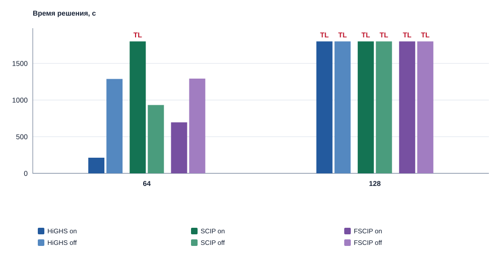

Время решения и статусы

| Задача | HiGHS on | HiGHS off | SCIP on | SCIP off | FSCIP on | FSCIP off |
|---|---:|---:|---:|---:|---:|---:|
| [64](hard-lp/lookup/64/README.md) | 213,42 с · решено | 1288,03 с · решено | TL (1800 с) | 932,26 с · решено | 696,09 с · решено | 1292,73 с · решено |
| [128](hard-lp/lookup/128/README.md) | TL (1800 с) | TL (1800 с) | TL (1800 с) | TL (1800 с) | TL (1800 с) | TL (1800 с) |

### musl-inet-ntop

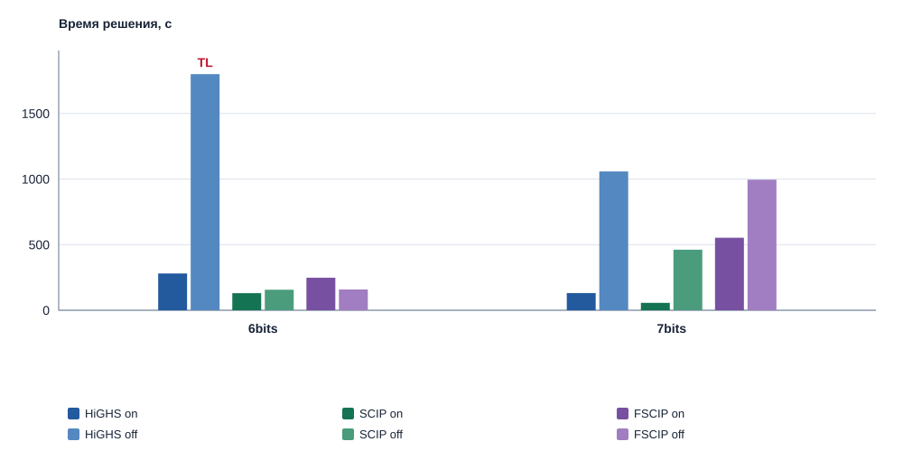

Время решения и статусы

| Задача | HiGHS on | HiGHS off | SCIP on | SCIP off | FSCIP on | FSCIP off |
|---|---:|---:|---:|---:|---:|---:|
| [6bits](hard-lp/musl-inet-ntop/6bits/README.md) | 280,54 с · решено | TL (1800 с) | 130,23 с · решено | 156,52 с · решено | 248,12 с · решено | 158,72 с · решено |
| [7bits](hard-lp/musl-inet-ntop/7bits/README.md) | 131,11 с · решено | 1058,1 с · решено | 56,54 с · решено | 461,71 с · решено | 552,87 с · решено | 995,4 с · решено |

### nginx-roundrobin

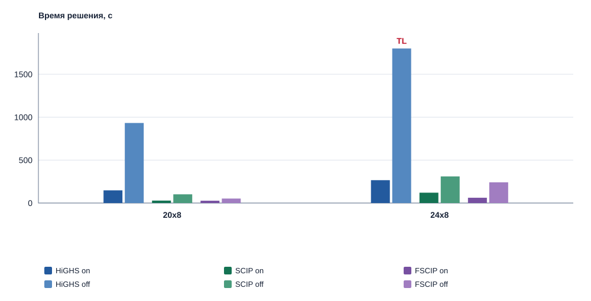

Время решения и статусы

| Задача | HiGHS on | HiGHS off | SCIP on | SCIP off | FSCIP on | FSCIP off |
|---|---:|---:|---:|---:|---:|---:|
| [20x8](hard-lp/nginx-roundrobin/20x8/README.md) | 147,88 с · решено | 932,4 с · решено | 28,47 с · решено | 101,48 с · решено | 26,83 с · решено | 52,09 с · решено |
| [24x8](hard-lp/nginx-roundrobin/24x8/README.md) | 266,25 с · решено | TL (1800 с) | 120,43 с · решено | 309,98 с · решено | 61,5 с · решено | 241,32 с · решено |

### numeric

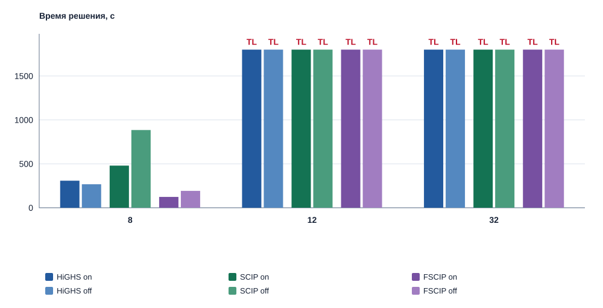

Время решения и статусы

| Задача | HiGHS on | HiGHS off | SCIP on | SCIP off | FSCIP on | FSCIP off |
|---|---:|---:|---:|---:|---:|---:|
| [8](hard-lp/numeric/8/README.md) | 308 с · решено | 267,46 с · решено | 479,66 с · решено | 884,65 с · решено | 123,31 с · решено | 192,02 с · решено |
| [12](hard-lp/numeric/12/README.md) | TL (1800 с) | TL (1800 с) | TL (1800 с) | TL (1800 с) | TL (1800 с) | TL (1800 с) |
| [32](hard-lp/numeric/32/README.md) | TL (1800 с) | TL (1800 с) | TL (1800 с) | TL (1800 с) | TL (1800 с) | TL (1800 с) |

### of-match

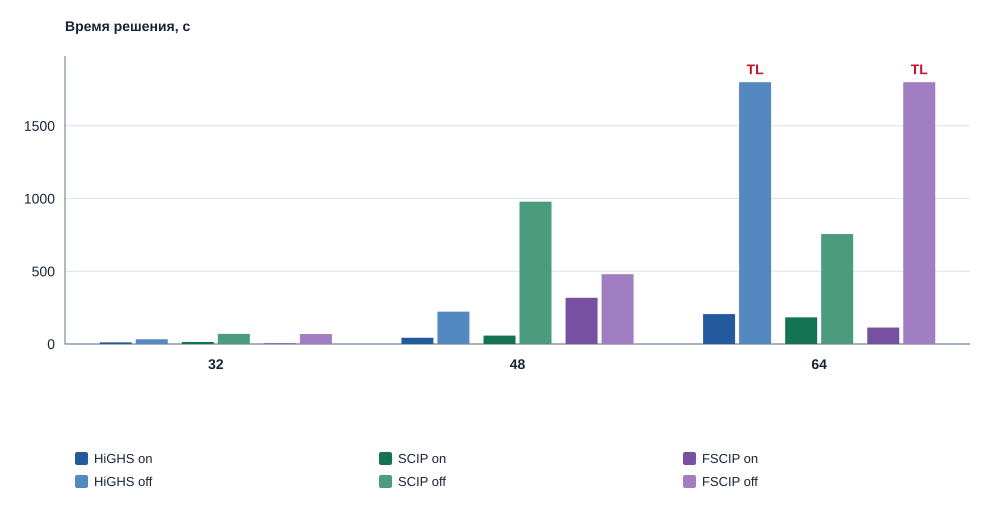

Время решения и статусы

| Задача | HiGHS on | HiGHS off | SCIP on | SCIP off | FSCIP on | FSCIP off |
|---|---:|---:|---:|---:|---:|---:|
| [32](hard-lp/of-match/32/README.md) | 11,24 с · решено | 32,5 с · решено | 13,84 с · решено | 69,59 с · решено | 4,17 с · решено | 68,38 с · решено |
| [48](hard-lp/of-match/48/README.md) | 42,86 с · решено | 222,34 с · решено | 57,78 с · решено | 978,55 с · решено | 317,78 с · решено | 479,92 с · решено |
| [64](hard-lp/of-match/64/README.md) | 205,6 с · решено | TL (1800 с) | 183,14 с · решено | 755,87 с · решено | 113,18 с · решено | TL (1800 с) |

### openssh-overlap

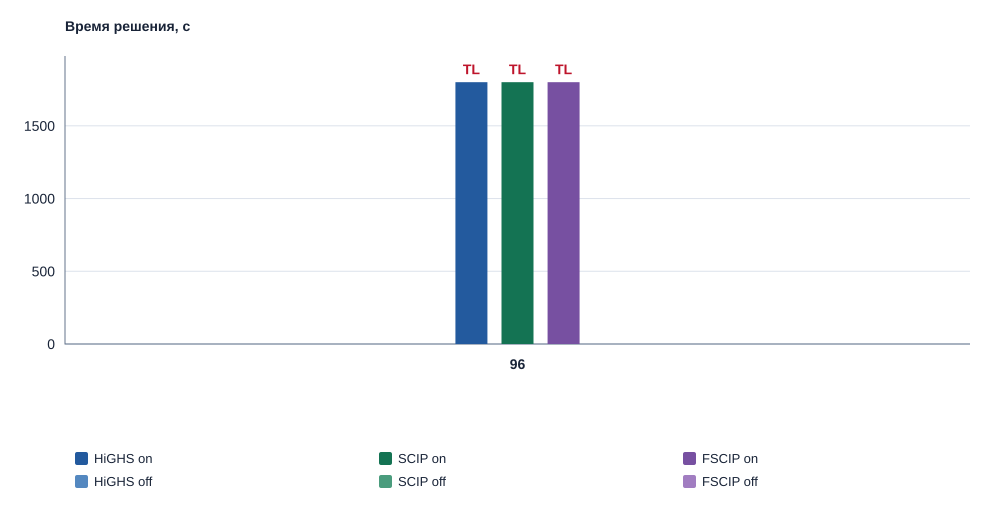

Время решения и статусы

| Задача | HiGHS on | HiGHS off | SCIP on | SCIP off | FSCIP on | FSCIP off |
|---|---:|---:|---:|---:|---:|---:|
| [96](hard-lp/openssh-overlap/96/README.md) | TL (1800 с) | — | TL (1800 с) | — | TL (1800 с) | — |

### pg-acl

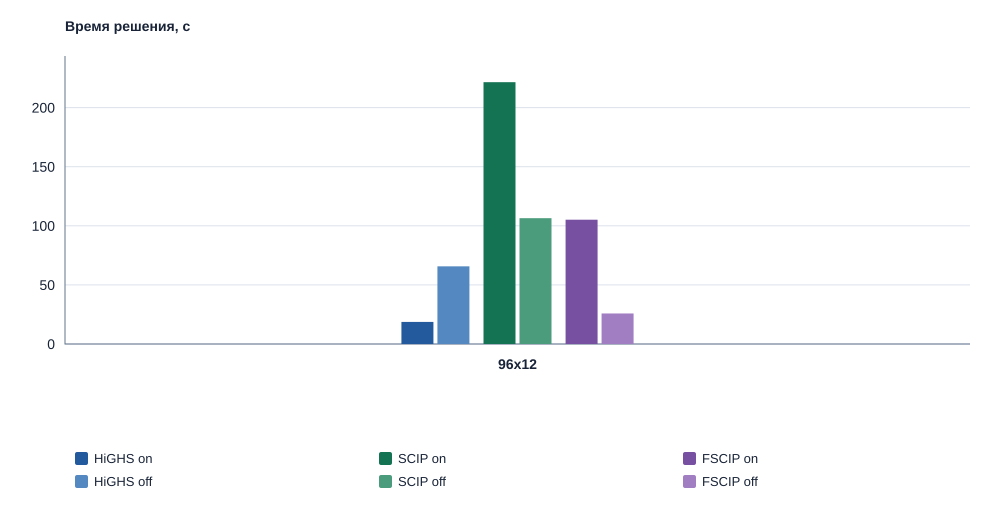

Время решения и статусы

| Задача | HiGHS on | HiGHS off | SCIP on | SCIP off | FSCIP on | FSCIP off |
|---|---:|---:|---:|---:|---:|---:|
| [96x12](hard-lp/pg-acl/96x12/README.md) | 18,68 с · решено | 65,71 с · решено | 221,52 с · решено | 106,45 с · решено | 105,16 с · решено | 25,83 с · решено |

### redis-acl

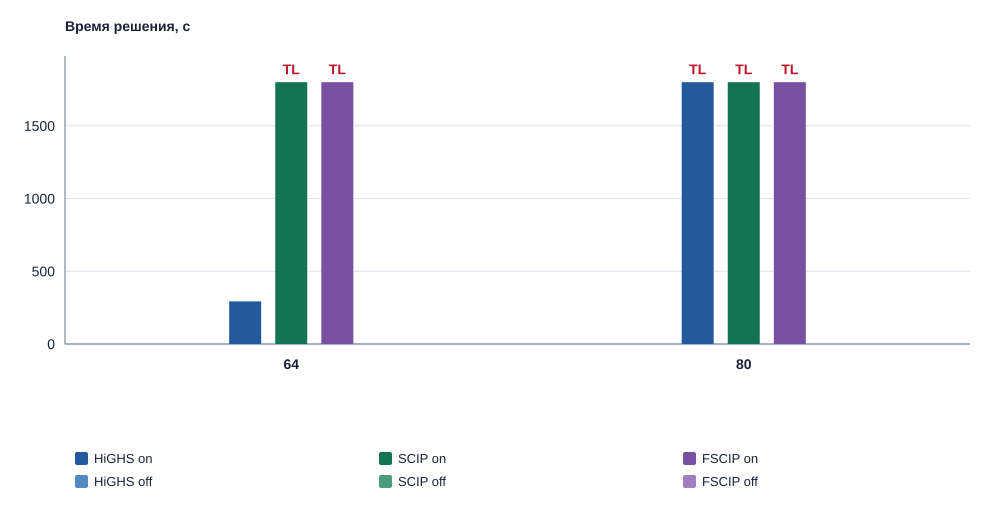

Время решения и статусы

| Задача | HiGHS on | HiGHS off | SCIP on | SCIP off | FSCIP on | FSCIP off |
|---|---:|---:|---:|---:|---:|---:|
| [64](hard-lp/redis-acl/64/README.md) | 292,87 с · решено | — | TL (1800 с) | — | TL (1800 с) | — |
| [80](hard-lp/redis-acl/80/README.md) | TL (1800 с) | — | TL (1800 с) | — | TL (1800 с) | — |

### zlib

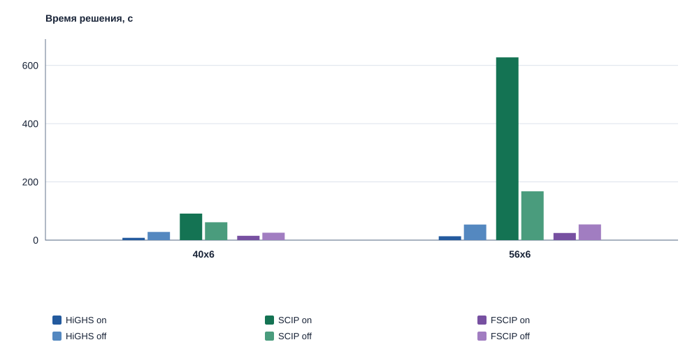

Время решения и статусы

| Задача | HiGHS on | HiGHS off | SCIP on | SCIP off | FSCIP on | FSCIP off |
|---|---:|---:|---:|---:|---:|---:|
| [40x6](hard-lp/zlib/40x6/README.md) | 7,89 с · решено | 28,09 с · решено | 91,1 с · решено | 61,36 с · решено | 14,88 с · решено | 25,47 с · решено |
| [56x6](hard-lp/zlib/56x6/README.md) | 13,3 с · решено | 53,51 с · решено | 627,56 с · решено | 167,63 с · решено | 24,54 с · решено | 53,91 с · решено |

## [`branching`](branching/)

### bzip2-blocksort

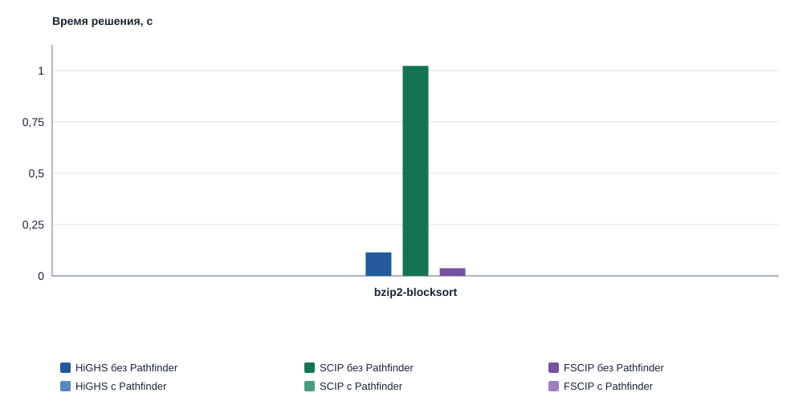

Время решения и статусы

| Задача | HiGHS без Pathfinder | HiGHS с Pathfinder | SCIP без Pathfinder | SCIP с Pathfinder | FSCIP без Pathfinder | FSCIP с Pathfinder |
|---|---:|---:|---:|---:|---:|---:|
| [bzip2-blocksort](branching/real-code/bzip2-blocksort/results.json) | 0,114466 с · статус не записан | — | 1,02291 с · статус не записан | — | 0,03731 с · OPTIMAL | — |

### dpdk-acl-f4n16

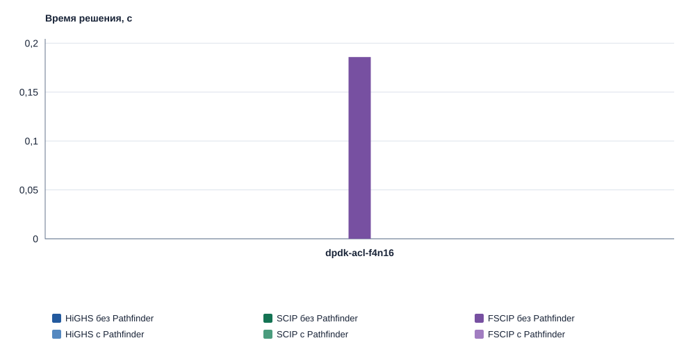

Время решения и статусы

| Задача | HiGHS без Pathfinder | HiGHS с Pathfinder | SCIP без Pathfinder | SCIP с Pathfinder | FSCIP без Pathfinder | FSCIP с Pathfinder |
|---|---:|---:|---:|---:|---:|---:|
| [dpdk-acl-f4n16](branching/real-code/dpdk-acl-f4n16/results.json) | — | — | — | — | 0,185854 с · OPTIMAL | — |

### if

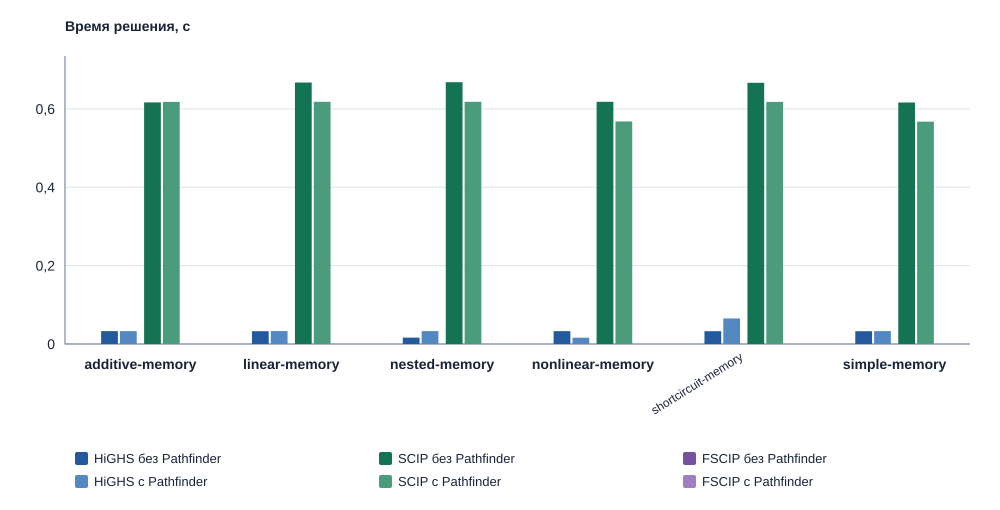

Время решения и статусы

| Задача | HiGHS без Pathfinder | HiGHS с Pathfinder | SCIP без Pathfinder | SCIP с Pathfinder | FSCIP без Pathfinder | FSCIP с Pathfinder |
|---|---:|---:|---:|---:|---:|---:|
| [additive-memory](branching/sintetic-code/if-additive-memory/results.json) | 0,032871 с · статус не записан | 0,032851 с · статус не записан | 0,616563 с · статус не записан | 0,617913 с · статус не записан | — | — |
| [linear-memory](branching/sintetic-code/if-linear-memory/results.json) | 0,032669 с · статус не записан | 0,032955 с · статус не записан | 0,667333 с · статус не записан | 0,618124 с · статус не записан | — | — |
| [nested-memory](branching/sintetic-code/if-nested-memory/results.json) | 0,016265 с · статус не записан | 0,032918 с · статус не записан | 0,668187 с · статус не записан | 0,618103 с · статус не записан | — | — |
| [nonlinear-memory](branching/sintetic-code/if-nonlinear-memory/results.json) | 0,032806 с · статус не записан | 0,016102 с · статус не записан | 0,618097 с · статус не записан | 0,568023 с · статус не записан | — | — |
| [shortcircuit-memory](branching/sintetic-code/if-shortcircuit-memory/results.json) | 0,032673 с · статус не записан | 0,065164 с · статус не записан | 0,666644 с · статус не записан | 0,617834 с · статус не записан | — | — |
| [simple-memory](branching/sintetic-code/if-simple-memory/results.json) | 0,032591 с · статус не записан | 0,032912 с · статус не записан | 0,616332 с · статус не записан | 0,567452 с · статус не записан | — | — |

### libpcap

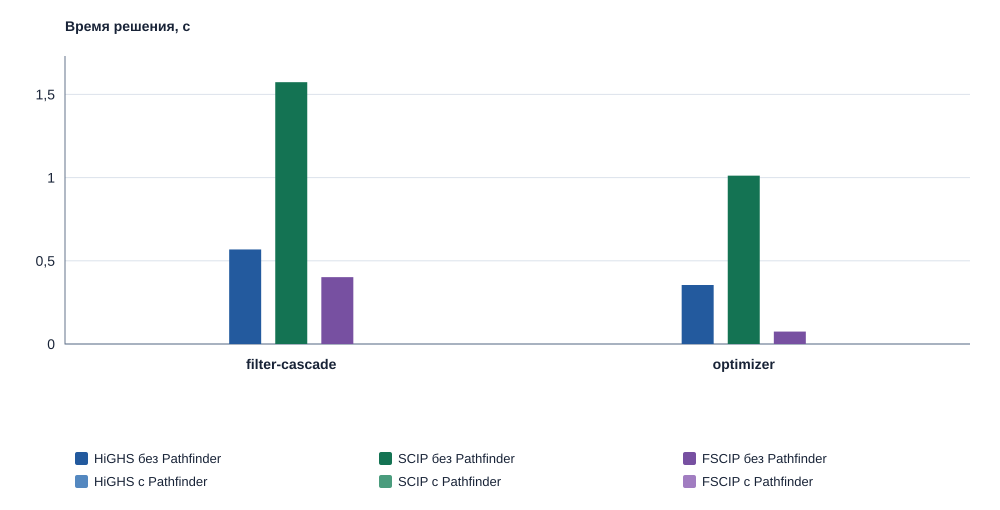

Время решения и статусы

| Задача | HiGHS без Pathfinder | HiGHS с Pathfinder | SCIP без Pathfinder | SCIP с Pathfinder | FSCIP без Pathfinder | FSCIP с Pathfinder |
|---|---:|---:|---:|---:|---:|---:|
| [filter-cascade](branching/real-code/libpcap-filter-cascade/results.json) | 0,568144 с · OPTIMAL | INFEASIBLE | 1,573385 с · OPTIMAL | INFEASIBLE | 0,401786 с · OPTIMAL | — |
| [optimizer](branching/real-code/libpcap-optimizer/results.json) | 0,354556 с · статус не записан | — | 1,011681 с · статус не записан | — | 0,074677 с · OPTIMAL | — |

### pcre2-match

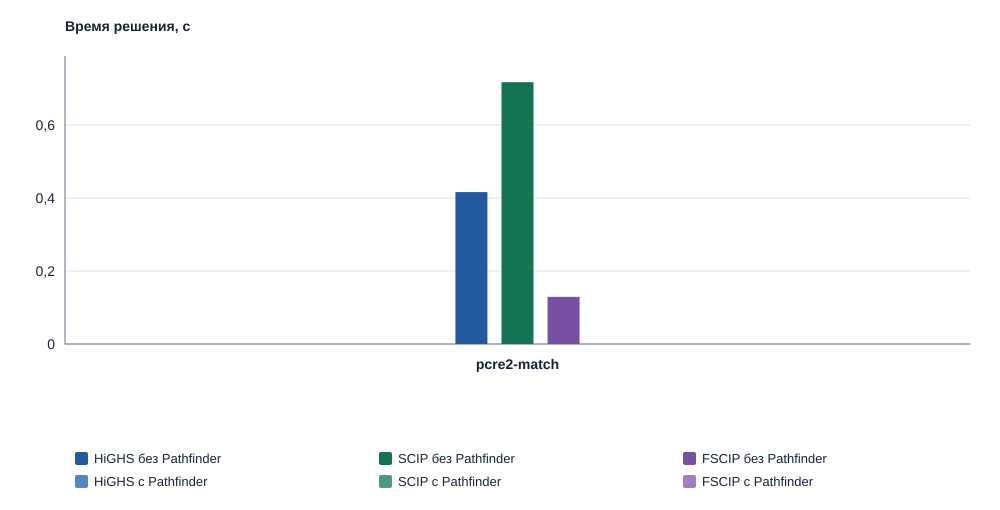

Время решения и статусы

| Задача | HiGHS без Pathfinder | HiGHS с Pathfinder | SCIP без Pathfinder | SCIP с Pathfinder | FSCIP без Pathfinder | FSCIP с Pathfinder |
|---|---:|---:|---:|---:|---:|---:|
| [pcre2-match](branching/real-code/pcre2-match/results.json) | 0,416235 с · OPTIMAL | — | 0,717376 с · OPTIMAL | — | 0,129227 с · OPTIMAL | — |

### switch

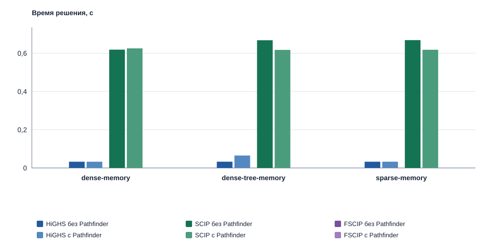

Время решения и статусы

| Задача | HiGHS без Pathfinder | HiGHS с Pathfinder | SCIP без Pathfinder | SCIP с Pathfinder | FSCIP без Pathfinder | FSCIP с Pathfinder |
|---|---:|---:|---:|---:|---:|---:|
| [dense-memory](branching/sintetic-code/switch-dense-memory/results.json) | 0,03262 с · статус не записан | 0,032633 с · статус не записан | 0,618801 с · статус не записан | 0,625472 с · статус не записан | — | — |
| [dense-tree-memory](branching/sintetic-code/switch-dense-tree-memory/results.json) | 0,032783 с · статус не записан | 0,06502 с · статус не записан | 0,668026 с · статус не записан | 0,617476 с · статус не записан | — | — |
| [sparse-memory](branching/sintetic-code/switch-sparse-memory/results.json) | 0,032639 с · статус не записан | 0,032719 с · статус не записан | 0,6686 с · статус не записан | 0,61815 с · статус не записан | — | — |

### wireshark-lz77

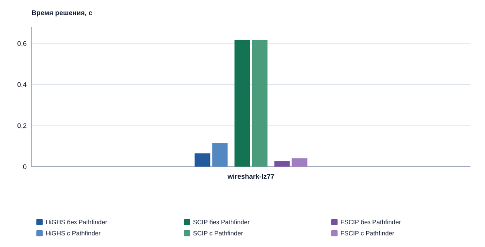

Время решения и статусы

| Задача | HiGHS без Pathfinder | HiGHS с Pathfinder | SCIP без Pathfinder | SCIP с Pathfinder | FSCIP без Pathfinder | FSCIP с Pathfinder |
|---|---:|---:|---:|---:|---:|---:|
| [wireshark-lz77](branching/real-code/wireshark-lz77/results.json) | 0,065003 с · OPTIMAL | 0,115024 с · OPTIMAL | 0,617605 с · OPTIMAL | 0,617737 с · OPTIMAL | 0,027746 с · OPTIMAL | 0,040808 с · OPTIMAL |

### zstd-block

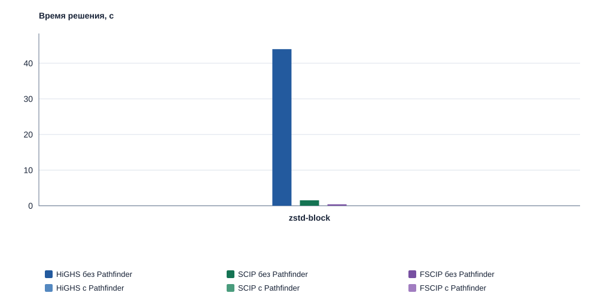

Время решения и статусы

| Задача | HiGHS без Pathfinder | HiGHS с Pathfinder | SCIP без Pathfinder | SCIP с Pathfinder | FSCIP без Pathfinder | FSCIP с Pathfinder |
|---|---:|---:|---:|---:|---:|---:|
| [zstd-block](branching/real-code/zstd-block/results.json) | 43,946767 с · OPTIMAL | — | 1,523556 с · OPTIMAL | — | 0,392272 с · OPTIMAL | — |

## [`branching-loops`](branching-loops/)

### alternating

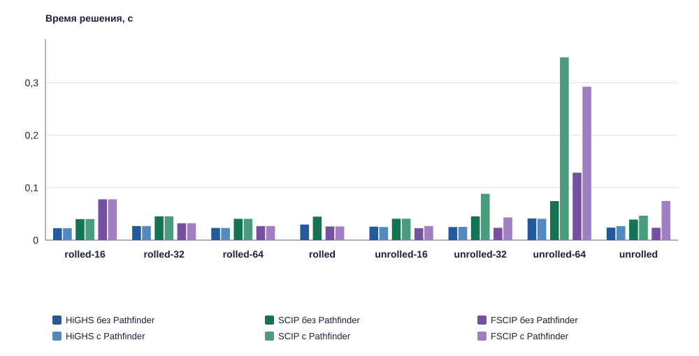

Время решения и статусы

| Задача | HiGHS без Pathfinder | HiGHS с Pathfinder | SCIP без Pathfinder | SCIP с Pathfinder | FSCIP без Pathfinder | FSCIP с Pathfinder |
|---|---:|---:|---:|---:|---:|---:|
| [rolled-16](branching-loops/sintetic-code/alternating-rolled-16/results.json) | 0,022781 с · OPTIMAL | 0,022781 с · OPTIMAL | 0,040109 с · OPTIMAL | 0,040109 с · OPTIMAL | 0,077843 с · OPTIMAL | 0,077843 с · OPTIMAL |
| [rolled-32](branching-loops/sintetic-code/alternating-rolled-32/results.json) | 0,026879 с · OPTIMAL | 0,026879 с · OPTIMAL | 0,045246 с · OPTIMAL | 0,045246 с · OPTIMAL | 0,032243 с · OPTIMAL | 0,032243 с · OPTIMAL |
| [rolled-64](branching-loops/sintetic-code/alternating-rolled-64/results.json) | 0,023203 с · OPTIMAL | 0,023203 с · OPTIMAL | 0,040594 с · OPTIMAL | 0,040594 с · OPTIMAL | 0,026842 с · OPTIMAL | 0,026842 с · OPTIMAL |
| [rolled](branching-loops/sintetic-code/alternating-rolled/results.json) | 0,029666 с · статус не записан | — | 0,044744 с · статус не записан | — | 0,026054 с · статус не записан | 0,026054 с · статус не записан |
| [unrolled-16](branching-loops/sintetic-code/alternating-unrolled-16/results.json) | 0,025647 с · OPTIMAL | 0,02493 с · OPTIMAL | 0,040741 с · OPTIMAL | 0,040894 с · OPTIMAL | 0,022779 с · OPTIMAL | 0,026895 с · OPTIMAL |
| [unrolled-32](branching-loops/sintetic-code/alternating-unrolled-32/results.json) | 0,024946 с · OPTIMAL | 0,025248 с · OPTIMAL | 0,045189 с · OPTIMAL | 0,088387 с · OPTIMAL | 0,023516 с · OPTIMAL | 0,043315 с · OPTIMAL |
| [unrolled-64](branching-loops/sintetic-code/alternating-unrolled-64/results.json) | 0,041314 с · OPTIMAL | 0,040677 с · OPTIMAL | 0,074425 с · OPTIMAL | 0,348392 с · OPTIMAL | 0,128537 с · OPTIMAL | 0,292438 с · OPTIMAL |
| [unrolled](branching-loops/sintetic-code/alternating-unrolled/results.json) | 0,023838 с · статус не записан | 0,026737 с · статус не записан | 0,039181 с · статус не записан | 0,046651 с · статус не записан | 0,023578 с · статус не записан | 0,074689 с · статус не записан |

### budget

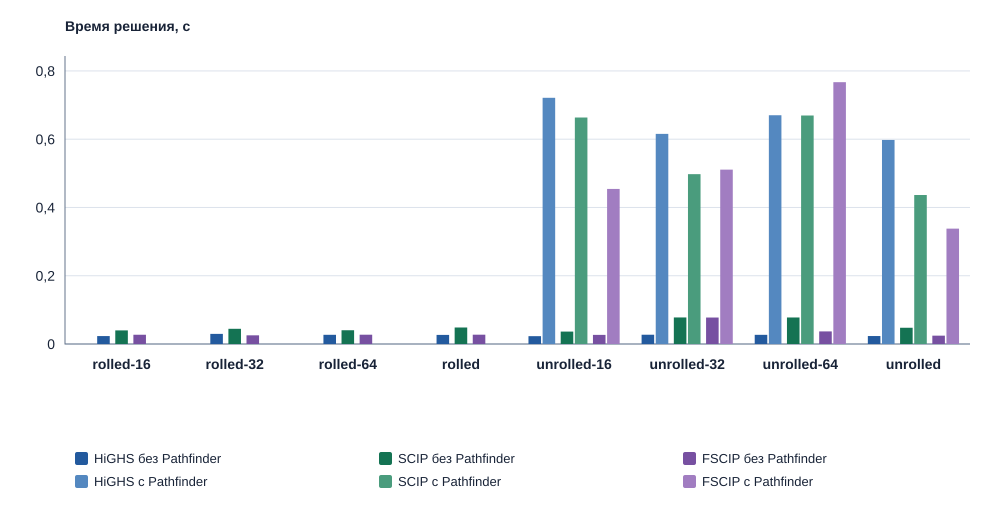

Время решения и статусы

| Задача | HiGHS без Pathfinder | HiGHS с Pathfinder | SCIP без Pathfinder | SCIP с Pathfinder | FSCIP без Pathfinder | FSCIP с Pathfinder |
|---|---:|---:|---:|---:|---:|---:|
| [rolled-16](branching-loops/sintetic-code/budget-rolled-16/results.json) | 0,023234 с · OPTIMAL | — | 0,039859 с · OPTIMAL | — | 0,027124 с · OPTIMAL | — |
| [rolled-32](branching-loops/sintetic-code/budget-rolled-32/results.json) | 0,029636 с · OPTIMAL | — | 0,044525 с · OPTIMAL | — | 0,025406 с · OPTIMAL | — |
| [rolled-64](branching-loops/sintetic-code/budget-rolled-64/results.json) | 0,026944 с · OPTIMAL | — | 0,040296 с · OPTIMAL | — | 0,02722 с · OPTIMAL | — |
| [rolled](branching-loops/sintetic-code/budget-rolled/results.json) | 0,026643 с · статус не записан | — | 0,048336 с · статус не записан | — | 0,027272 с · статус не записан | — |
| [unrolled-16](branching-loops/sintetic-code/budget-unrolled-16/results.json) | 0,02294 с · OPTIMAL | 0,721279 с · OPTIMAL | 0,036371 с · OPTIMAL | 0,663523 с · OPTIMAL | 0,026724 с · OPTIMAL | 0,454303 с · OPTIMAL |
| [unrolled-32](branching-loops/sintetic-code/budget-unrolled-32/results.json) | 0,027163 с · OPTIMAL | 0,615584 с · OPTIMAL | 0,077759 с · OPTIMAL | 0,497578 с · OPTIMAL | 0,077545 с · OPTIMAL | 0,510849 с · OPTIMAL |
| [unrolled-64](branching-loops/sintetic-code/budget-unrolled-64/results.json) | 0,026873 с · OPTIMAL | 0,670182 с · OPTIMAL | 0,077677 с · OPTIMAL | 0,669406 с · OPTIMAL | 0,036879 с · OPTIMAL | 0,767033 с · OPTIMAL |
| [unrolled](branching-loops/sintetic-code/budget-unrolled/results.json) | 0,023345 с · статус не записан | 0,597764 с · статус не записан | 0,047587 с · статус не записан | 0,436479 с · статус не записан | 0,024444 с · статус не записан | 0,338001 с · статус не записан |

### independent

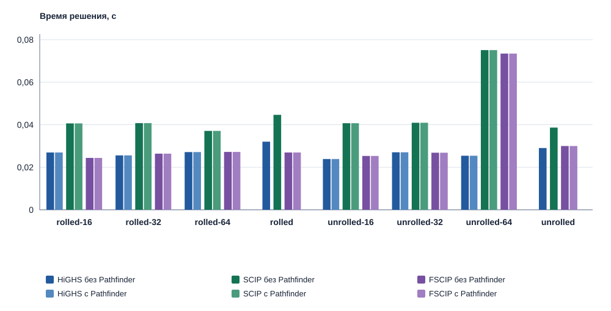

Время решения и статусы

| Задача | HiGHS без Pathfinder | HiGHS с Pathfinder | SCIP без Pathfinder | SCIP с Pathfinder | FSCIP без Pathfinder | FSCIP с Pathfinder |
|---|---:|---:|---:|---:|---:|---:|
| [rolled-16](branching-loops/sintetic-code/independent-rolled-16/results.json) | 0,026934 с · OPTIMAL | 0,026934 с · OPTIMAL | 0,040617 с · OPTIMAL | 0,040617 с · OPTIMAL | 0,024391 с · OPTIMAL | 0,024391 с · OPTIMAL |
| [rolled-32](branching-loops/sintetic-code/independent-rolled-32/results.json) | 0,025573 с · OPTIMAL | 0,025573 с · OPTIMAL | 0,040754 с · OPTIMAL | 0,040754 с · OPTIMAL | 0,026389 с · OPTIMAL | 0,026389 с · OPTIMAL |
| [rolled-64](branching-loops/sintetic-code/independent-rolled-64/results.json) | 0,027133 с · OPTIMAL | 0,027133 с · OPTIMAL | 0,037093 с · OPTIMAL | 0,037093 с · OPTIMAL | 0,027204 с · OPTIMAL | 0,027204 с · OPTIMAL |
| [rolled](branching-loops/sintetic-code/independent-rolled/results.json) | 0,032024 с · статус не записан | — | 0,044643 с · статус не записан | — | 0,026933 с · статус не записан | 0,026933 с · статус не записан |
| [unrolled-16](branching-loops/sintetic-code/independent-unrolled-16/results.json) | 0,023869 с · OPTIMAL | 0,023869 с · OPTIMAL | 0,040701 с · OPTIMAL | 0,040701 с · OPTIMAL | 0,025314 с · OPTIMAL | 0,025314 с · OPTIMAL |
| [unrolled-32](branching-loops/sintetic-code/independent-unrolled-32/results.json) | 0,027036 с · OPTIMAL | 0,027036 с · OPTIMAL | 0,040917 с · OPTIMAL | 0,040917 с · OPTIMAL | 0,026831 с · OPTIMAL | 0,026831 с · OPTIMAL |
| [unrolled-64](branching-loops/sintetic-code/independent-unrolled-64/results.json) | 0,025408 с · OPTIMAL | 0,025408 с · OPTIMAL | 0,075081 с · OPTIMAL | 0,075081 с · OPTIMAL | 0,073456 с · OPTIMAL | 0,073456 с · OPTIMAL |
| [unrolled](branching-loops/sintetic-code/independent-unrolled/results.json) | 0,029032 с · статус не записан | — | 0,038644 с · статус не записан | — | 0,02998 с · статус не записан | 0,02998 с · статус не записан |

### linux-dml

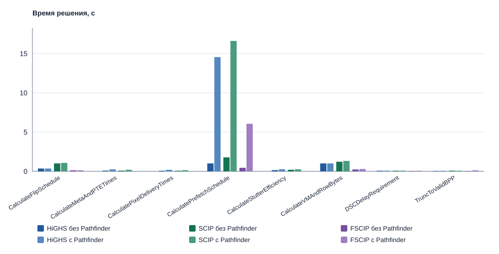

Время решения и статусы

| Задача | HiGHS без Pathfinder | HiGHS с Pathfinder | SCIP без Pathfinder | SCIP с Pathfinder | FSCIP без Pathfinder | FSCIP с Pathfinder |
|---|---:|---:|---:|---:|---:|---:|
| [CalculateFlipSchedule](branching-loops/real-code/linux-dml/dml32_CalculateFlipSchedule/results.json) | 0,355483 с · OPTIMAL | 0,355158 с · OPTIMAL | 1,011802 с · OPTIMAL | 1,071687 с · OPTIMAL | 0,122644 с · OPTIMAL | 0,129629 с · OPTIMAL |
| [CalculateMetaAndPTETimes](branching-loops/real-code/linux-dml/dml32_CalculateMetaAndPTETimes/results.json) | 0,090452 с · статус не записан | 0,249639 с · статус не записан | 0,086897 с · статус не записан | 0,19634 с · статус не записан | — | — |
| [CalculatePixelDeliveryTimes](branching-loops/real-code/linux-dml/dml32_CalculatePixelDeliveryTimes/results.json) | 0,075099 с · статус не записан | 0,191766 с · статус не записан | 0,076324 с · статус не записан | 0,142269 с · статус не записан | — | — |
| [CalculatePrefetchSchedule](branching-loops/real-code/linux-dml/dml32_CalculatePrefetchSchedule/results.json) | 1,006027 с · OPTIMAL | 14,548288 с · OPTIMAL | 1,774955 с · OPTIMAL | 16,608828 с · OPTIMAL | 0,451482 с · OPTIMAL | 6,051834 с · OPTIMAL |
| [CalculateStutterEfficiency](branching-loops/real-code/linux-dml/dml32_CalculateStutterEfficiency/results.json) | 0,15039 с · статус не записан | 0,262327 с · статус не записан | 0,197907 с · статус не записан | 0,252915 с · статус не записан | — | — |
| [CalculateVMAndRowBytes](branching-loops/real-code/linux-dml/dml32_CalculateVMAndRowBytes/results.json) | 1,006921 с · OPTIMAL | 1,005516 с · OPTIMAL | 1,220791 с · OPTIMAL | 1,322869 с · OPTIMAL | 0,242481 с · OPTIMAL | 0,294647 с · OPTIMAL |
| [DSCDelayRequirement](branching-loops/real-code/linux-dml/dml32_DSCDelayRequirement/results.json) | 0,076521 с · OPTIMAL | 0,083691 с · OPTIMAL | 0,075605 с · OPTIMAL | 0,084885 с · OPTIMAL | 0,040441 с · OPTIMAL | 0,077521 с · OPTIMAL |
| [TruncToValidBPP](branching-loops/real-code/linux-dml/dml32_TruncToValidBPP/results.json) | 0,043579 с · OPTIMAL | 0,068376 с · OPTIMAL | 0,08086 с · OPTIMAL | 0,081421 с · OPTIMAL | 0,038082 с · OPTIMAL | 0,126094 с · OPTIMAL |

### threshold

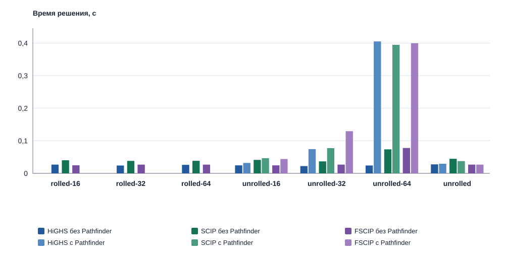

Время решения и статусы

| Задача | HiGHS без Pathfinder | HiGHS с Pathfinder | SCIP без Pathfinder | SCIP с Pathfinder | FSCIP без Pathfinder | FSCIP с Pathfinder |
|---|---:|---:|---:|---:|---:|---:|
| [rolled-16](branching-loops/sintetic-code/threshold-rolled-16/results.json) | 0,026861 с · OPTIMAL | — | 0,040188 с · OPTIMAL | — | 0,024775 с · OPTIMAL | — |
| [rolled-32](branching-loops/sintetic-code/threshold-rolled-32/results.json) | 0,024044 с · OPTIMAL | — | 0,038277 с · OPTIMAL | — | 0,02682 с · OPTIMAL | — |
| [rolled-64](branching-loops/sintetic-code/threshold-rolled-64/results.json) | 0,026109 с · OPTIMAL | — | 0,038489 с · OPTIMAL | — | 0,026793 с · OPTIMAL | — |
| [unrolled-16](branching-loops/sintetic-code/threshold-unrolled-16/results.json) | 0,024556 с · OPTIMAL | 0,031952 с · OPTIMAL | 0,041348 с · OPTIMAL | 0,04666 с · OPTIMAL | 0,024589 с · OPTIMAL | 0,044069 с · OPTIMAL |
| [unrolled-32](branching-loops/sintetic-code/threshold-unrolled-32/results.json) | 0,022291 с · OPTIMAL | 0,074458 с · OPTIMAL | 0,036729 с · OPTIMAL | 0,077376 с · OPTIMAL | 0,026837 с · OPTIMAL | 0,129515 с · OPTIMAL |
| [unrolled-64](branching-loops/sintetic-code/threshold-unrolled-64/results.json) | 0,024155 с · OPTIMAL | 0,405261 с · OPTIMAL | 0,07374 с · OPTIMAL | 0,394846 с · OPTIMAL | 0,077927 с · OPTIMAL | 0,399669 с · OPTIMAL |
| [unrolled](branching-loops/sintetic-code/threshold-unrolled/results.json) | 0,027571 с · статус не записан | 0,02945 с · статус не записан | 0,044697 с · статус не записан | 0,03767 с · статус не записан | 0,026841 с · статус не записан | 0,026866 с · статус не записан |

## [`loop-unrolling`](loop-unrolling/)

### frr

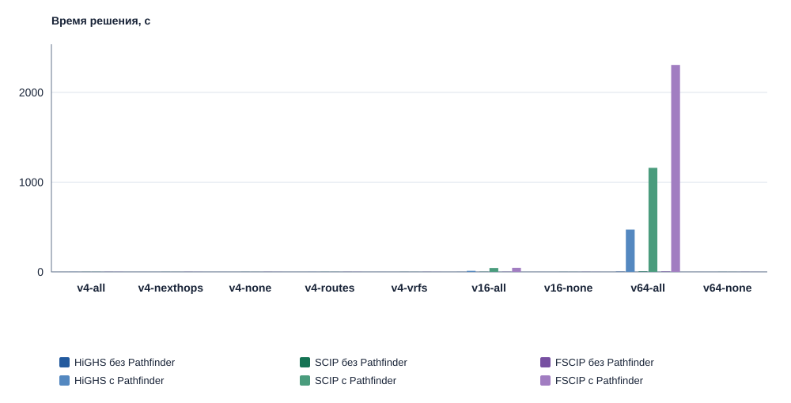

Время решения и статусы

| Задача | HiGHS без Pathfinder | HiGHS с Pathfinder | SCIP без Pathfinder | SCIP с Pathfinder | FSCIP без Pathfinder | FSCIP с Pathfinder |
|---|---:|---:|---:|---:|---:|---:|
| [v4-all](loop-unrolling/real-code/frr/frr-v4-all/results.json) | 0,165752 с · статус не записан | 0,819182 с · статус не записан | 0,768847 с · статус не записан | 1,121535 с · статус не записан | 1,01225 с · статус не записан | 1,372764 с · статус не записан |
| [v4-nexthops](loop-unrolling/real-code/frr/frr-v4-nexthops/results.json) | 0,032581 с · статус не записан | 0,032852 с · статус не записан | 0,567957 с · статус не записан | 0,568076 с · статус не записан | 1,011588 с · статус не записан | 1,011659 с · статус не записан |
| [v4-none](loop-unrolling/real-code/frr/frr-v4-none/results.json) | 0,032682 с · статус не записан | 0,065039 с · статус не записан | 0,618009 с · статус не записан | 0,567663 с · статус не записан | 1,011825 с · статус не записан | 1,011944 с · статус не записан |
| [v4-routes](loop-unrolling/real-code/frr/frr-v4-routes/results.json) | 0,065029 с · статус не записан | 0,567856 с · статус не записан | 0,668568 с · статус не записан | 0,970471 с · статус не записан | 1,012392 с · статус не записан | 1,321745 с · статус не записан |
| [v4-vrfs](loop-unrolling/real-code/frr/frr-v4-vrfs/results.json) | 0,032851 с · статус не записан | 0,06521 с · статус не записан | 0,618564 с · статус не записан | 0,61812 с · статус не записан | 1,011944 с · статус не записан | 1,012113 с · статус не записан |
| [v16-all](loop-unrolling/real-code/frr/frr-v16-all/results.json) | 0,567409 с · статус не записан | 11,472912 с · статус не записан | 1,56905 с · статус не записан | 42,831884 с · статус не записан | 1,523413 с · статус не записан | 44,885346 с · статус не записан |
| [v16-none](loop-unrolling/real-code/frr/frr-v16-none/results.json) | 0,032862 с · статус не записан | 0,032608 с · статус не записан | 0,567984 с · статус не записан | 0,617966 с · статус не записан | 1,011996 с · статус не записан | 1,012037 с · статус не записан |
| [v64-all](loop-unrolling/real-code/frr/frr-v64-all/results.json) | 2,777653 с · статус не записан | 470,929543 с · статус не записан | 4,944235 с · статус не записан | 1159,064189 с · статус не записан | 4,338747 с · статус не записан | 2305,92996 с · статус не записан |
| [v64-none](loop-unrolling/real-code/frr/frr-v64-none/results.json) | 0,032708 с · статус не записан | 0,032916 с · статус не записан | 0,56822 с · статус не записан | 0,573747 с · статус не записан | 1,013117 с · статус не записан | 1,010077 с · статус не записан |

### pipeline

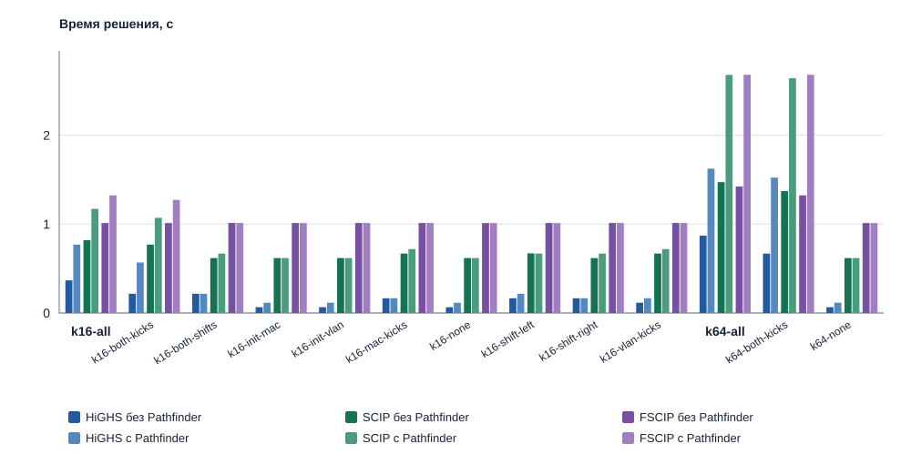

Время решения и статусы

| Задача | HiGHS без Pathfinder | HiGHS с Pathfinder | SCIP без Pathfinder | SCIP с Pathfinder | FSCIP без Pathfinder | FSCIP с Pathfinder |
|---|---:|---:|---:|---:|---:|---:|
| [k16-all](loop-unrolling/real-code/pipeline/pipeline-k16-all/results.json) | 0,366852 с · статус не записан | 0,76851 с · статус не записан | 0,81876 с · статус не записан | 1,170954 с · статус не записан | 1,012329 с · статус не записан | 1,322341 с · статус не записан |
| [k16-both-kicks](loop-unrolling/real-code/pipeline/pipeline-k16-both-kicks/results.json) | 0,215973 с · статус не записан | 0,568021 с · статус не записан | 0,769224 с · статус не записан | 1,070438 с · статус не записан | 1,011689 с · статус не записан | 1,272565 с · статус не записан |
| [k16-both-shifts](loop-unrolling/real-code/pipeline/pipeline-k16-both-shifts/results.json) | 0,21626 с · статус не записан | 0,215891 с · статус не записан | 0,618092 с · статус не записан | 0,668173 с · статус не записан | 1,013104 с · статус не записан | 1,012524 с · статус не записан |
| [k16-init-mac](loop-unrolling/real-code/pipeline/pipeline-k16-init-mac/results.json) | 0,065051 с · статус не записан | 0,115334 с · статус не записан | 0,617919 с · статус не записан | 0,618098 с · статус не записан | 1,011687 с · статус не записан | 1,011821 с · статус не записан |
| [k16-init-vlan](loop-unrolling/real-code/pipeline/pipeline-k16-init-vlan/results.json) | 0,065176 с · статус не записан | 0,11547 с · статус не записан | 0,617989 с · статус не записан | 0,618012 с · статус не записан | 1,012207 с · статус не записан | 1,012114 с · статус не записан |
| [k16-mac-kicks](loop-unrolling/real-code/pipeline/pipeline-k16-mac-kicks/results.json) | 0,165083 с · статус не записан | 0,165818 с · статус не записан | 0,668258 с · статус не записан | 0,718863 с · статус не записан | 1,012619 с · статус не записан | 1,012353 с · статус не записан |
| [k16-none](loop-unrolling/real-code/pipeline/pipeline-k16-none/results.json) | 0,06473 с · статус не записан | 0,114593 с · статус не записан | 0,618127 с · статус не записан | 0,618017 с · статус не записан | 1,011722 с · статус не записан | 1,011647 с · статус не записан |
| [k16-shift-left](loop-unrolling/real-code/pipeline/pipeline-k16-shift-left/results.json) | 0,165561 с · статус не записан | 0,215962 с · статус не записан | 0,67102 с · статус не записан | 0,668282 с · статус не записан | 1,012344 с · статус не записан | 1,011825 с · статус не записан |
| [k16-shift-right](loop-unrolling/real-code/pipeline/pipeline-k16-shift-right/results.json) | 0,165394 с · статус не записан | 0,165632 с · статус не записан | 0,617827 с · статус не записан | 0,668204 с · статус не записан | 1,012818 с · статус не записан | 1,012512 с · статус не записан |
| [k16-vlan-kicks](loop-unrolling/real-code/pipeline/pipeline-k16-vlan-kicks/results.json) | 0,115496 с · статус не записан | 0,16576 с · статус не записан | 0,668426 с · статус не записан | 0,718536 с · статус не записан | 1,012386 с · статус не записан | 1,012047 с · статус не записан |
| [k64-all](loop-unrolling/real-code/pipeline/pipeline-k64-all/results.json) | 0,869584 с · статус не записан | 1,624239 с · статус не записан | 1,47212 с · статус не записан | 2,67904 с · статус не записан | 1,423004 с · статус не записан | 2,679835 с · статус не записан |
| [k64-both-kicks](loop-unrolling/real-code/pipeline/pipeline-k64-both-kicks/results.json) | 0,668399 с · статус не записан | 1,523203 с · статус не записан | 1,371822 с · статус не записан | 2,641497 с · статус не записан | 1,322981 с · статус не записан | 2,680096 с · статус не записан |
| [k64-none](loop-unrolling/real-code/pipeline/pipeline-k64-none/results.json) | 0,065135 с · статус не записан | 0,115416 с · статус не записан | 0,617993 с · статус не записан | 0,618059 с · статус не записан | 1,012011 с · статус не записан | 1,011317 с · статус не записан |

